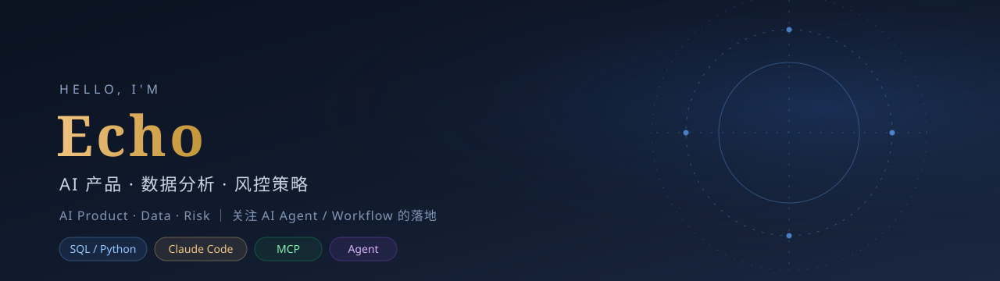

  

### 你好，我是 Echo 👋

我关注 **AI 产品、数据分析与风控策略**，喜欢把模糊的业务问题拆成可落地的产品，再用 AI 工具快速做原型、验证、迭代。

- 🔭 现在在做：AI Agent / Workflow 的产品化实践
- 🧰 常用：SQL · Python · Claude Code · Cursor · MCP
- 🎯 方向：AI 产品 / 数据分析 / 风控策略
- 📫 联系：欢迎通过 GitHub 交流

## Selected work

| 项目 | 是什么 | 技术 / 关键词 | 链接 |
| --- | --- | --- | --- |
| **甄嬛传 MBTI** | 20 道宫廷情境题，五维娱乐性格测试，匹配 23 个角色 | Vue 3 · Vite · Tailwind | [在线体验](https://echozmecin-commits.github.io/zhenhuan-mbti/) · [代码](https://github.com/echozmecin-commits/zhenhuan-mbti) |
| **AI 命理** | 本地排盘 + 本地解读，可选大模型综合解读；无 Key / 超时自动降级 | 单页 HTML/JS · lunar-javascript · DeepSeek | [在线体验](https://echozmecin-commits.github.io/ai-mingli/) · [代码](https://github.com/echozmecin-commits/ai-mingli) |
| **A 股数据工具** | 市场概览、K 线、资金流、龙虎榜、规则选股 | Next.js · TypeScript · FastAPI · AKShare | [代码](https://github.com/echozmecin-commits/a-share-tool) |
| **秋招筛选站** | 校招机会筛选、核验、投递记录与待办 | Next.js · 数据产品 · 校招 | [代码](https://github.com/echozmecin-commits/campus-jobs-2027) |
| **AI 模拟面试官 Skill** | 基于 JD + 简历生成个性化面试问题（多作者项目，参与贡献） | LLM · Prompt · 面试 | [代码](https://github.com/echozmecin-commits/interview-skills) |

## 我在关注

- **AI 产品从 0 到 1**：Agent、Workflow、RAG、评估标准与失败降级
- **数据驱动的策略运营**：指标体系、实验设计、归因分析
- **风控与平台治理**：规则、处置策略、证据化验收

## Toolbox

  
  
  
  
  
  
  

---

  把业务问题做成产品，再用 AI 把它做得更快一点。

